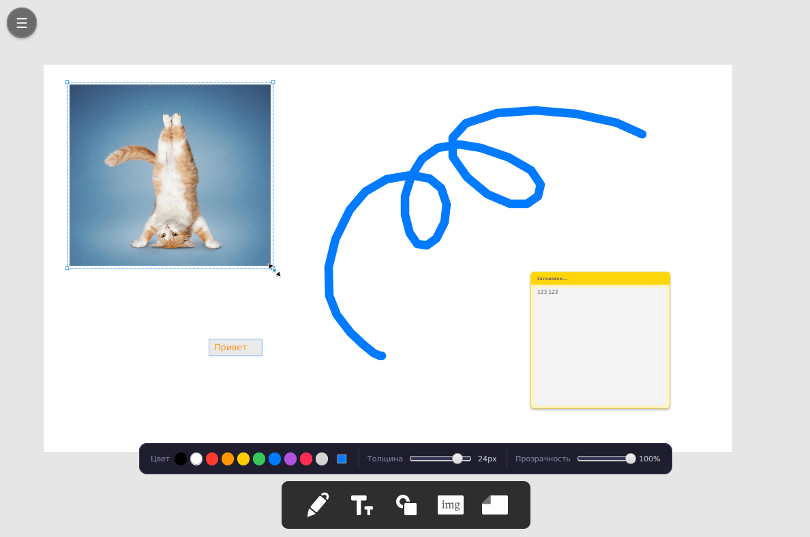

# CanvasProject2

Desktop-приложение для рисования на JavaFX с отдельным WebSocket-сервером для совместной работы. Сервер хранит аккаунты, канвасы и элементы в MongoDB.



## Возможности

- Рисование линий, фигур, заметок и изображений.
- Вход и регистрация.
- Совместная работа через WebSocket: синхронизация элементов и курсоров.
- Приглашения пользователей по коду.

## Структура

- `src/` — основной JavaFX-клиент.
- `java-collab/server/` — отдельный WebSocket-сервер и MongoDB-интеграция.
- `pom.xml` — зависимости и сборка клиента.
- `java-collab/server/pom.xml` — зависимости и сборка сервера.

## Требования

- JDK 17 или новее для клиента.
- JDK 21 для сервера.
- MongoDB для хранения данных.

В репозитории есть Maven Wrapper, поэтому отдельно устанавливать Maven не требуется.

## Локальный запуск с нуля

Проекту требуются **две разные версии Java**: JDK 17 для клиента и JDK 21 для сервера. 
Ниже приведены инструкции по настройке с нуля для Linux (на примере Void Linux) и Windows.

### Шаг 1: Создайте файл `.env`

В корневой папке проекта создайте файл `.env` со следующим содержимым по дефолту:

```env
MONGO_URI=mongodb://localhost:27017
WS_URL=ws://localhost:8765
```

---

## 🐧 Запуск на Linux (Void Linux)

### 1. Установка JDK 17 и JDK 21

```bash
sudo xbps-install -S openjdk17 openjdk21
source /etc/profile.d/jdk.sh
```

### 2. Установка и запуск MongoDB (через Docker)

```bash
# Установка Docker (если еще нет)
sudo xbps-install -S docker
sudo ln -s /etc/sv/docker /var/service/
sudo sv start docker

# Запуск контейнера MongoDB
sudo docker run -d --name mongodb-local -p 27017:27017 mongo:latest
```

### 3. Запуск сервера (в первом терминале)

```bash
# Указываем JDK 21
export JAVA_HOME=/usr/lib/jvm/openjdk21

# Сборка сервера
./mvnw -B -f java-collab/server/pom.xml package

# Экспорт переменных и запуск
set -a
source .env
set +a
$JAVA_HOME/bin/java -jar java-collab/server/target/canvas-collab-server-1.0.0.jar
```

### 4. Запуск клиента (во втором терминале)

```bash
# Указываем JDK 17
export JAVA_HOME=/usr/lib/jvm/openjdk17

# Экспорт переменных и запуск
set -a
source .env
set +a
./mvnw javafx:run
```

---

## 🪟 Запуск на Windows

### 1. Установка JDK 17 и JDK 21

Откройте PowerShell от имени администратора и используйте `winget`:

```powershell
winget install --id EclipseAdoptium.Temurin.17.JDK --exact --silent
winget install --id EclipseAdoptium.Temurin.21.JDK --exact --silent
```

### 2. Установка и запуск MongoDB

1. Скачайте установщик MongoDB Community Server для Windows (.msi).
2. Запустите установщик, выберите "Complete".
3. **Обязательно** отметьте галочку **"Install MongoDB as a Service"** (тогда база будет работать в фоне).
4. После установки проверьте работу в новом терминале командой `mongosh`.

### 3. Запуск сервера (в первом терминале PowerShell)

```powershell
# Укажите ваш реальный путь к JDK 21
$env:JAVA_HOME = "C:\Program Files\Eclipse Adoptium\jdk-21.0.8.9-hotspot"

# Сборка сервера
.\mvnw.cmd -B -f java-collab\server\pom.xml package

# Загрузка переменных из .env в текущую сессию
Get-Content .env | ForEach-Object {
    if ($_ -match '^\s*([^#][^=]+)=(.*)$') {
        [System.Environment]::SetEnvironmentVariable($matches[1].Trim(), $matches[2].Trim(), 'Process')
    }
}

# Запуск сервера
& "$env:JAVA_HOME\bin\java.exe" -jar java-collab\server\target\canvas-collab-server-1.0.0.jar
```

### 4. Запуск клиента (во втором терминале PowerShell)

```powershell
# Укажите ваш реальный путь к JDK 17
$env:JAVA_HOME = "C:\Program Files\Eclipse Adoptium\jdk-17.0.16.8-hotspot"

# Загрузка переменных из .env
Get-Content .env | ForEach-Object {
    if ($_ -match '^\s*([^#][^=]+)=(.*)$') {
        [System.Environment]::SetEnvironmentVariable($matches[1].Trim(), $matches[2].Trim(), 'Process')
    }
}

# Запуск клиента
.\mvnw.cmd javafx:run
```

## Перед публичным развёртыванием

- Сервер сам по себе не настраивает TLS. Для внешнего доступа поставьте перед ним reverse proxy с TLS/WSS и задайте клиенту `WS_URL=wss://ваш-домен/...`; 