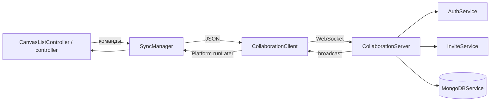

# AUDIT — Slate, фаза 0

Дата: 2026-11-22. Аудит по коду, а не по описанию. Ссылки — `файл:строка`
на момент коммита фазы 0. Приоритеты: **Critical** — потеря данных или дырка в
доступе; **High** — ломает основной сценарий; **Medium** — мешает, но есть
обход; **Low** — косметика/долг.

## 0. Статус после фазы 1 (2026-11-22)

Исправлено и покрыто тестами:

- C-01, C-02, C-05, C-06, C-07, C-08, H-01, H-11, H-12, H-18, H-19, H-20,
  H-21; M-01…M-09, M-11, M-12, M-14 (минимум ключа), M-15 (предупреждение для
  `ws://`), M-16 (сохранение размера/позиции окна), M-17 (ru/en), M-22.
- Локализация: все строки клиента вынесены в `messages_ru/en.properties`;
  диалоги, ошибки и подписи кнопок берутся из бандла.
- Мёртвый код `LOGIN/REGISTER/LOGOUT`, `login.fxml`, `register.fxml`,
  `LoginController`, `RegisterController` и дубли `java-collab/client` удалены;
  неиспользуемые `formsfx`/`gesturefx` убраны.

Осознанно оставлено на следующие фазы: C-03 (ключ в буфере), C-04 (таймаут
молчащего сокета), H-02 (ассеты вместо base64), H-03…H-06, H-07 (офлайн-очередь),
H-08 (заменён единым диспетчером, проверять в фазе 4), H-09, H-10, H-13…H-17,
M-10 (вставка из буфера/drag-and-drop), M-13 (гибкие приглашения), M-18…M-21,
M-23…M-26.

## 1. Архитектура

Два независимых Maven-проекта: клиент (JavaFX 17, корень) и сервер (Java 21,
`java-collab/server`). Транспорт — WebSocket/JSON, хранилище — MongoDB.
Клиент не имеет локального хранилища: без сервера он не работает, поэтому
целевой сценарий «только я» сейчас не выполнен.

- Вход: `Launcher` → `main` → `canvas-list.fxml` →
  `CanvasListController` (подключение, `AUTH_DEVICE`, список досок).
- Доска: `CanvasListController.openCanvas` загружает `canvas-view.fxml`,
  создаёт `controller`, передаёт размер и элементы.
- `controller` (981 строка) владеет сценой, инструментами, выделением,
  историей (`CommandManager`), `BoardModel` и `SyncManager`.
- `SyncManager` — единственное место сериализации элементов; вызывает
  `CollaborationClient` и принимает входящие сообщения.
- Сервер: `ServerMain` читает env/TLS, поднимает `CollaborationServer`
  (`sessions`, `rooms`), авторизует по SHA-256 ключа, проверяет роли и
  транслирует изменения в комнату. `MongoDBService` — синглтон с коллекциями
  `users`, `canvases`, `invite_codes`, `device_tokens`.

Потокобезопасность в целом корректная: сетевые колбэки `CollaborationClient`
заворачивают обработчик в `Platform.runLater` (`CollaborationClient.java:61`),
`SyncManager` тоже обновляет сцену только в UI-потоке
(`SyncManager.java:124,132,146,161`). Сервер использует `ConcurrentHashMap` для
сессий и комнат. Слабые места перечислены ниже.

## 2. Данные

- `CanvasDocument` хранит **все элементы внутри документа доски**
  (`CanvasDocument.java:18`), а не отдельной коллекцией. Лимит документа Mongo —
  16 МБ; картинки лежат base64 внутри элемента, поэтому доска с несколькими
  фотографиями упирается в лимит.
- Роли: `owner`, `editor`, `viewer`; отсутствие роли у участника трактуется как
  `editor` для старых досок (`CanvasDocument.java:43-49`). Владельца нельзя
  понизить через `memberRoles` — проверка owner идёт первой.
- Приглашение: код 8 символов, TTL и число использований; `isValid()` проверяет
  срок и `usedCount` (`InviteCode.java:40-42`), атомарное списание — в
  `MongoDBService.consumeInvite` (`:392-403`).
- Токен — 30 дней, TTL-индекс Mongo (`MongoDBService.java:21,56-58`).
- Ключ устройства — 32 байта Base64URL в `~/.config/canvasproject/device.json`
  с правами 600 (`DeviceIdentity.java:25-31,100-110`). Сервер хранит только
  SHA-256 (`AuthService.java:49-51`).

## 3. Дефекты

### Critical

| # | Дефект | Где | Последствие |
|---|---|---|---|
| C-01 | «Очистить всё» удаляет все элементы без подтверждения и без записи в Undo; в режиме наблюдателя кнопка тоже работает локально | `controller.java:529-539` | необратимая потеря содержимого, в т.ч. гостем |
| C-02 | Размер холста не синхронизируется и не хранится на сервере; наблюдатель может менять его локально | `controller.java:365-399`, `CanvasSizeCache.java:10-16`; на сервере нет типа сообщения | участники видят разные размеры, «ресайз» гостя теряется |
| C-03 | Ключ устройства копируется в системный буфер как обычный текст | `DeviceKeyDialog.java:57-59` | ключ = пароль; буфер доступен другим приложениям |
| C-04 | Таймаут авторизации проверяется только при входящем сообщении; молчащее соединение не закрывается | `CollaborationServer.java:101-114` | незалогиненные сокеты висят вечно и занимают лимит IP |
| C-05 | На каждый `CURSOR_MOVE` сервер читает **весь документ доски** со всеми элементами, чтобы проверить роль; клиент шлёт курсор на каждое движение мыши без троттлинга | `CollaborationServer.java:613-626`, `MongoDBService.java:208-215`, `controller.java:761-764` | при нескольких участниках и большой доске — постоянные многомегабайтные чтения и деградация БД |
| C-06 | `LEAVE_CANVAS` с произвольным `canvasId` обнуляет активную доску, но не удаляет сокет из прежней комнаты | `CollaborationServer.java:413-423,634-644` | «призрачный» участник, утечка сокета, `USER_LEFT` не приходит |
| C-07 | После разрыва связи реконнект ставит обработчиком сообщений `CanvasListController`, а не доску; повторного `JOIN_CANVAS` и перезагрузки нет | `CanvasListController.java:105-129,167-199`, `controller.java:174-215` | живая синхронизация умирает: правки пишутся в БД, но другие их не видят до перезахода; ошибки не показываются |
| C-08 | Undo/Redo меняют только локальную модель; `onClearAll` не очищает историю | `controller.java:517-539`, `CommandManager.java:24-38` | отменённое добавление остаётся на сервере, redo «воскрешает» удалённое только локально, участники расходятся |

### High

| # | Дефект | Где | Последствие |
|---|---|---|---|
| H-01 | Цвет и размер шрифта текста не сериализуются; размер шрифта стикера тоже | `SyncManager.java:207-214` (text), `:237-248` (note), `:346-354` | у других участников текст чёрный и стандартного размера |
| H-02 | Картинки передаются и хранятся как base64 внутри JSON/документа без ресайза и лимита | `SyncManager.java:262-300`, `controller.java:781-789` | 6 МБ на элемент, 16 МБ на документ, тяжёлые broadcast'ы |
| H-03 | `ADD_ELEMENT` не проверяет допустимый `elementType` (пустой тип проходит) и уникальность id | `CollaborationServer.java:524-560` | мусор в БД, дубликаты, несовместимые клиенты |
| H-04 | `UPDATE_ELEMENT`/`DELETE_ELEMENT` для несуществующего элемента всё равно рассылают успех | `CollaborationServer.java:562-611`, `MongoDBService.java:306-326` | клиенты расходятся с БД, ошибка не видна |
| H-05 | `$addToSet` по всему документу элемента создаёт дубликат при повторном добавлении того же id с другими данными | `MongoDBService.java:289-300` | дубли в `elements`, «пропавшие» правки |
| H-06 | Счётчик соединений на IP уменьшается дважды для отклонённого соединения | `CollaborationServer.java:65-74,81-89` | лимит `MAX_CONNECTIONS_PER_IP` обходится |
| H-07 | Нет переподключения и офлайн-очереди; при обрыве сообщения молча теряются | `CollaborationClient.java:96-111` | правки пропадают, пользователь не понимает почему |
| H-08 | Диалог приглашения подменяет глобальный обработчик сообщений и не пропускает события доски | `InviteCodeDialog.java:71-97` | пока диалог открыт, чужие изменения не применяются |
| H-09 | Текст исключения уходит клиенту | `CollaborationServer.java:154-159` | утечка внутренних деталей и путей |
| H-10 | Нет лимитов на число досок/элементов и длину имени доски | `CollaborationServer.java:328-337` | один клиент забивает БД |
| H-11 | Наблюдатель может локально очистить холст и изменить размер, хотя рисование запрещено | `controller.java:365,529`; блокируются только инструменты | ложное ощущение прав, рассинхрон |
| H-12 | `UPDATE_ELEMENT` без `data` подставляет `{}` и затирает элемент | `CollaborationServer.java:590-591,602` | один некорректный пакет уничтожает рисунок |
| H-13 | Повторный `AUTH_DEVICE` на активном соединении меняет личность, но не выходит из комнаты | `CollaborationServer.java:177-205` | новый пользователь продолжает получать чужую доску |
| H-14 | Любой editor может отозвать код, созданный владельцем; результат отзыва игнорируется | `CollaborationServer.java:504-522` | срыв приглашений, ложный `INVITE_REVOKED` |
| H-15 | Нет проверки `Origin` и обязательного TLS; `ws://` принимается молча | `ServerMain.java:23-33`, `CollaborationServer.java:65-78` | CSWSH/DNS-rebinding из браузера, перехват ключа |
| H-16 | Погашение кода и добавление участника — две операции без транзакции; результат добавления не проверяется | `InviteService.java:62-65` | код сгорел, участник не добавлен |
| H-17 | Нет API отзыва участника и смены роли, хотя методы БД есть | `MongoDBService.java:264-287` не вызываются | доступ нельзя отозвать иначе как удалением доски |
| H-18 | Наблюдатель может двигать и ресайзить элементы, менять фон; блокируются только кнопки инструментов | `controller.java:218-230`, `SelectionManager.java:40-52`, `SelectionOverlay.java:77-181` | локально доска «портится», сервер правку отклоняет, ошибка скрыта |
| H-19 | В обработчике доски нет ветки `ERROR` | `controller.java:194-207` | отказ в правах, антифлуд и «элемент слишком большой» выглядят как «ничего не произошло» |
| H-20 | Единственный `messageHandler` перезаписывается экранами и диалогами; `runLater` читает поле в момент выполнения | `CollaborationClient.java:57-65`, `InviteCodeDialog.java:27,71-90`, `ProfileDialog.java:43,170-184` | сообщения теряются или попадают не тому обработчику; любой `ERROR` трактуется как ошибка диалога |
| H-21 | `new Image(url, true)` для не-`data:` источника: клиент по команде участника ходит на произвольный URL; MIME не проверяется | `SyncManager.java:390-410` | утечка IP, трекинг, подмена типа файла |

### Medium

| # | Дефект | Где | Последствие |
|---|---|---|---|
| M-01 | Диалог «Изменить размер» без `style-auth.css` — светлая Modena | `controller.java:367-382` | выбивается из тёмного UI |
| M-02 | Подсказка «400–4000» врёт: высота минимум 300; значения зажимаются молча | `controller.java:381,387-388` | пользователь не понимает, почему ввод изменён |
| M-03 | Ошибки «Новой доски» пишутся в статус **за** диалогом, диалог закрывается и теряет ввод | `CanvasListController.java:293-308` | нужно заново открывать и вводить |
| M-04 | `ButtonType.OK/CANCEL/CLOSE` — английские подписи во всех диалогах | `CanvasListController.java:259,406-414`, `InviteCodeDialog.java:118`, `controller.java:370` | смешанный язык |
| M-05 | `ChoiceBox` роли не стилизован: светлый popup, белый текст | `InviteCodeDialog.java:47-55`; в CSS нет `.choice-box` | роль не читается |
| M-06 | Окно меняет размер при переходах: 980×660 → 1280×820 → 960×640 | `main.java:26`, `CanvasListController.java:630`, `controller.java:344` | окно «прыгает», позиция/максимизация не запоминаются |
| M-07 | Сетка есть в коде, но включить её нечем | `controller.java:68,464`; `showGrid` всегда false | мёртвая функция |
| M-08 | Одиночный клик пером не создаёт точку: линия с одной точкой удаляется | `controller.java:721-758` | точка не рисуется |
| M-09 | Правки текста стикера не попадают в Undo | `stickyNote.java:76`, `SyncManager.watchTextChanges` | нельзя отменить опечатку |
| M-10 | Картинка всегда вставляется в (100,100), без Ctrl+V и drag-and-drop | `controller.java:786-787` | неудобно и непредсказуемо |
| M-11 | Тост «Имя присоединился» без склонения/нейтральной формы | `controller.java:199,974` | неграмотный текст для женских имён |
| M-12 | Локальный кэш размера перекрывает серверный при входе | `CanvasListController.java:617-622` | после смены размера другим участником гость видит старый |
| M-13 | Кнопка «Код приглашения» умеет только 24 ч / 1 использование; отзыва кодов в UI нет | `InviteCodeDialog.java:15,104-108` | заявленные в протоколе возможности недоступны |
| M-14 | Минимальная длина ключа: 16 у клиента, 32 у сервера | `DeviceIdentity.java:66-74`, `AuthService.java:43-46` | клиент принимает ключ, который сервер отвергнет |
| M-15 | `ws://` принимается без предупреждения; проверки отпечатка TLS нет | `AppSettings.java:29-37`, `CollaborationClient.java:23-25` | ключ и доски можно перехватить в LAN/интернете |
| M-16 | Смена сцены пересоздаёт контроллер: история Undo и выделение теряются при выходе с доски | `controller.java:333-349`, `CanvasListController.java:626-641` | нельзя вернуться и отменить |
| M-17 | Все строки в коде; локализации нет | весь `src/main/java`, FXML | нельзя переключить язык |
| M-18 | `MONGO_URI` печатается в лог, `.env` с правами 644 | `ServerMain.java:38`, `run-server.sh:55`, `.env` | при credentials в URI пароль виден локальным пользователям и в логах |
| M-19 | Код приглашения генерируется без повтора при коллизии; результат отзыва не проверяется | `MongoDBService.java:429-437`, `CollaborationServer.java:515` | редкая ошибка «Server error» и ложный успех отзыва |
| M-20 | Новый токен на каждый вход, старые живут 30 дней; лимита нет | `AuthService.java:74-78` | рост `device_tokens` |
| M-21 | Экспорт PNG захватывает слой чужих курсоров; после экспорта выделение включается безусловно; снимок по границам группы, а не листа | `controller.java:430-455`, `RemoteCursorOverlay.java:20-29` | курсоры в файле, лишние прозрачные поля, сбитое состояние UI |
| M-22 | `AppSettings` игнорирует `XDG_CONFIG_HOME`, `DeviceIdentity` учитывает | `AppSettings.java:16`, `DeviceIdentity.java:25-27` | ключ и настройки лежат в разных местах, README врёт |
| M-23 | `device.json` перезаписывается при каждом старте (меняется `createdAt`), права `600` только в `save()`, ошибки глотаются | `DeviceIdentity.java:87-100` | ложная история ключа, риск прав при сбое |
| M-24 | Тосты складываются в одной точке и не снимаются при смене сцены; список сбрасывает выделение на каждом `CANVAS_LIST`; ресайз окна перецентровывает холст | `controller.java:846-861,949-971`, `CanvasListController.java:428-436` | визуальный шум, потеря панорамирования и выбора |
| M-25 | Дубли FXML в `src/main/resources/img/`, устаревшая копия клиента в `java-collab/client/`, неиспользуемые `formsfx`/`gesturefx` | `pom.xml:32-51`, `resources/img/`, `java-collab/client/` | путаница, лишние зависимости |
| M-26 | Удалённое обновление текста безусловно делает `setText`, сбрасывая каретку и неотправленный ввод; заголовок заметки шлёт эхо-обновления | `SyncManager.java:417-445`, `stickyNote.java:73-78` | драка за текст, лишний трафик |

### Low

- Смешение стилей иконок (PNG + Feather) и подписей; часть плиток фигур
  обрезается при длинных переводах (`ToolbarPanel.java:204-238`).
- Классы в нижнем регистре (`command`, `drawable`, `main`, `customTextField`,
  `lineElement`) нарушают Java-соглашения.
- `LOGIN/REGISTER/LOGOUT`, `login.fxml`, `register.fxml`,
  `LoginController`, `RegisterController` — мёртвый код (см. `AUDIT` §5).
- `CanvasSizeCache` — статический `HashMap` без очистки; утечка на длинной сессии.
- Нет статус-бара (связь/роль/участники/масштаб), нет списка участников.

## 4. Права: что проверено

| Действие | owner | editor | viewer | Где |
|---|---|---|---|---|
| Читать доску | да | да | да | `handleJoinCanvas:360-397` |
| Добавлять/менять/удалять элементы | да | да | нет | `:524-611` |
| Переименовать/удалить доску | да | нет | нет | `MongoDBService.java:217-249` |
| Создать приглашение editor | да | нет | нет | `InviteService.java:34-39` |
| Создать приглашение viewer | да | да | нет | там же |
| Отозвать приглашение | да | да | нет | `:504-522` |
| Курсор | да | да | да | `:613-627` |

Проверки на сервере есть для всех операций; клиентская блокировка — только UI.
Интеграционный тест подтверждает отказ наблюдателю в `ADD_ELEMENT`, редактору —
в `RENAME_CANVAS` и в приглашении редактора.

## 5. Расхождения кода и документации

1. README обещает «бесконечный холст» (`README.md:10`), фактически лист
   1920×1080, максимум 4000×4000 (`CollaborationServer.java:332-335`).
2. README описывает три сценария, но сценарий 1 всё равно требует
   `run-server` и MongoDB (`README.md:95-105`); целевой solo-режим не реализован.
3. README говорит о тёмной теме, светлой/системной нет.
4. README: «коды одноразовые и живут 24 часа» — протокол умеет `hours`/`maxUses`,
   но UI это не выставляет.
5. `DESIGN_SYSTEM.md` описывает токены, но часть диалогов живёт на Modena
   (M-01), а `ChoiceBox` вообще без темы (M-05).
6. Лицензия MIT уже лежит в `LICENSE`; в задаче она значилась как нерешённая —
   зафиксировано в `DECISIONS.md` D-007.
7. README: настройки в `~/.config/canvasproject/settings.json` — фактически
   `AppSettings` не учитывает `XDG_CONFIG_HOME` (`AppSettings.java:16`).
8. README: наблюдателю запрещены изменения — drag/resize элементов доступны
   (H-18).
9. `DESIGN_SYSTEM.md`: док 280 px и кнопки 44×44 — фактически 365×70 и 50×50
   (`canvas-view.fxml:63-73`, `style.css:60-73`); часть токенов в
   `style-auth.css` отличается от описанных; inline-стили цветов есть в
   `controller.java`, `ToolbarPanel.java`, `RemoteCursorOverlay.java` и элементах.
10. `AGENTS.md` требует ресурсы локализации — бандлов нет, все строки в коде.

## 6. Технический долг

- Ручная сериализация в `SyncManager` без схемы и версии формата; сервер не
  валидирует `data` по типу. Нужен общий `ElementCodec` + JSON Schema.
- Модель элемента продублирована: клиентские классы-ноды и серверный
  `CanvasElement`/`Document`; кроме того, в `java-collab/client/` лежит
  устаревшая копия клиента, на которую ничего не ссылается.
- `controller` — 981 строка, смешаны сцена, инструменты, сеть, экспорт.
- Синглтоны (`SessionManager`, `MongoDBService`, `AuthService`,
  `InviteService`, `CanvasSizeCache`) затрудняют тесты; нет DI.
- Нет миграций формата и версии документа доски.
- Нет тестов UI (TestFX) и скриншот-тестов; JavaFX-контролы требуют toolkit.
- Сборка не проверяет сервер из корня; два независимых `pom.xml`.

## 7. Страховочные тесты фазы 0

Добавлено:

| Проект | Тест | Что фиксирует |
|---|---|---|
| клиент | `CommandManagerTest` | execute/undo/redo, очистка redo, лимит 100, clear |
| клиент | `CanvasSizeCacheTest` | дефолт 1920×1080, перезапись, пустые id |
| клиент | `ElementCodecTest` | round-trip фигуры и линии, opacity, точки, дефолты, неизвестный тип |
| сервер | `CanvasDocumentTest` | роли owner/editor/viewer, legacy-участники, запрет понижения владельца |
| сервер | `InviteCodeTest` | срок, использования, unlimited, роль по умолчанию |
| сервер | `CollaborationServerIntegrationTest` | два клиента, приглашение, broadcast, права viewer/editor, неверный и отозванный код |

Интеграционный тест включается только явно (`SLATE_INTEGRATION_TESTS=1`) и
только на БД, в имени которой есть `test`; иначе пропускается. Это защита от
удаления рабочих данных.

## 8. Что не проверено

- CI на GitHub не запускался (репозиторий локальный); workflow добавлен, локально
  проверены те же команды.
- Windows/macOS-сборка не запускалась: нет доступа к машинам. JavaFX-тесты
  используют только фигуры и не требуют дисплея, но это не гарантия для всех ОС.
- Реальный TLS/`wss://` и обратный прокси не тестировались.
- Поведение при 5–10 тыс. элементов не измерялось.
- Восстановление после падения приложения не реализовано и не тестировалось.
